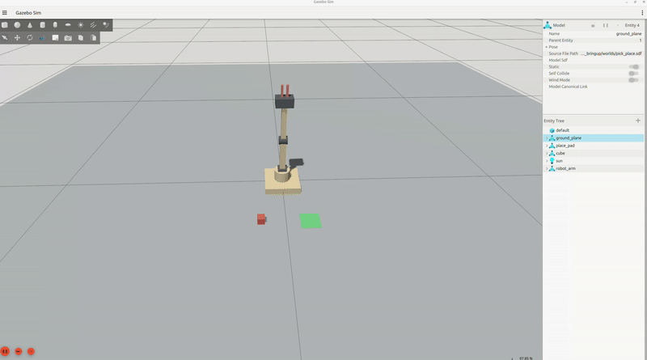

# ros2-robot-arm

A 4-joint robotic arm with a 2-finger gripper, built in **ROS 2 Jazzy** and **Gazebo Harmonic**.
Simulation comes first, then the same code drives a low-cost physical arm (hobby servos, plywood links).

- **Closed-form inverse kinematics** written from scratch (pure Python, unit-tested, no ROS needed to test it)
- **URDF/xacro model** whose dimensions are checked automatically against the kinematics code
- **ros2_control** setup for Gazebo: a joint trajectory controller for the arm and a position controller for the gripper
- **Pick-and-place demo**: the whole sequence is planned with IK before the arm moves
- **Static torque check** that estimates whether the planned servos can hold the arm



## The arm

| Joint | Name | Axis | Range |
|---|---|---|---|
| 1 | `base_yaw_joint` | z | ±90° |
| 2 | `shoulder_joint` | y | ±90° |
| 3 | `elbow_joint` | y | ±90° |
| 4 | `wrist_joint` | y | ±90° |
| Gripper | `finger_left_joint`, `finger_right_joint` | y (mirrored) | 0 – 30 mm each |

Link lengths: upper arm 150 mm, forearm 150 mm, wrist to fingertip 80 mm, shoulder axis 80 mm above the ground.
Maximum reach from the shoulder axis is 380 mm. All joints at zero means the arm points straight up.

The ±90° limits match hobby servos. With them, the arm can reach the ground with the gripper pointing
straight down at **about 212 – 298 mm** in front of the base. Allowing the tool to tilt (up to 90° away
from vertical, which the IK node does automatically) widens that to roughly **155 – 372 mm**.
Details in [docs/kinematics.md](docs/kinematics.md).

## Repository layout

```
ros2-robot-arm/
├── src/
│   ├── robot_arm_description/   URDF/xacro, RViz2 config, viewer launch file
│   ├── robot_arm_control/       kinematics, IK node, pick-and-place plan and demo, unit tests
│   └── robot_arm_bringup/       Gazebo world, controller config, launch files
├── tools/urdf_check.py          URDF vs kinematics check + servo torque estimate
├── scripts/install_deps.sh      installs the ROS 2 / Gazebo dependencies
├── docs/                        kinematics derivation, design notes, roadmap
└── .github/workflows/ci.yml     runs the unit tests on every push
```

The repository itself is a colcon workspace (it has a `src/` folder), so you can build it in place.

## Requirements

- Ubuntu 24.04
- ROS 2 Jazzy (`ros-jazzy-desktop`)
- Gazebo Harmonic (installed with `ros-jazzy-ros-gz`)

## Install and build

```bash
# 1. Clone
git clone https://github.com/Mrmoha01/robot_arm.git
cd ros2-robot-arm

# 2. Install dependencies (needs sudo)
./scripts/install_deps.sh

# 3. Build
source /opt/ros/jazzy/setup.bash
colcon build --symlink-install
source install/setup.bash
```

## Run

**Run the tests first** (no ROS needed):

```bash
python3 -m pytest src/robot_arm_control/test -v
```

**1. Look at the model in RViz2** and move the joints with sliders:

```bash
ros2 launch robot_arm_description display.launch.py
```

**2. Start the Gazebo simulation** (arm, cube, target pad, controllers):

```bash
ros2 launch robot_arm_bringup sim.launch.py
# add RViz2:  ros2 launch robot_arm_bringup sim.launch.py rviz:=true
```

**3. Run the pick-and-place demo** (in a second terminal, after `source install/setup.bash`):

```bash
ros2 launch robot_arm_bringup pick_place.launch.py
# run it once instead of looping:  ... pick_place.launch.py repeat:=false
```

**4. Or move the arm yourself** by sending the tool tip to a point (metres, `base_link` frame):

```bash
ros2 topic pub --once /target_point geometry_msgs/msg/PointStamped \
  "{header: {frame_id: base_link}, point: {x: 0.25, y: 0.0, z: 0.10}}"

# open / close the gripper (0.0 = closed, 0.03 = fully open)
ros2 topic pub --once /gripper_controller/commands std_msgs/msg/Float64MultiArray \
  "{data: [0.025, 0.025]}"
```

The IK node tilts the tool automatically if a point cannot be reached with the gripper pointing straight
down. Tune it with parameters, for example `ros2 run robot_arm_control ik_node --ros-args -p auto_pitch:=false`.

## Check the design

```bash
xacro src/robot_arm_description/urdf/robot_arm.urdf.xacro -o /tmp/robot_arm.urdf
python3 tools/urdf_check.py /tmp/robot_arm.urdf
```

This confirms the URDF matches `kinematics.py` and prints the static gravity torque on each joint
for the arm stretched out horizontally, against the servo limits. With the default masses the shoulder
has a margin of about 1.6× at full stretch with a 50 g payload, which is thin for a hobby servo.
See [docs/design.md](docs/design.md) for what to do about it.

## How it works

```
 /target_point ──► ik_node ──┐
                             ├─► /arm_controller/joint_trajectory ──► joint_trajectory_controller ──┐
 pick_place_demo ────────────┤                                                                      ├─► gz_ros2_control ─► Gazebo
                             └─► /gripper_controller/commands ─────► position controller ───────────┘
```

The code above the hardware interface does not depend on whether the arm is simulated or real.
For the physical arm, only the `<hardware>` plugin in
[`robot_arm.ros2_control.xacro`](src/robot_arm_description/urdf/robot_arm.ros2_control.xacro) changes.

## Troubleshooting

- **The arm drifts, sags or shakes in Gazebo.** Position control in `gz_ros2_control` depends on the joint
  dynamics. Tune `damping` in the URDF joints and the effort limits; lower `move_time` speeds are gentler.
- **`Waiting for arm_controller...` never ends.** Check that the controllers loaded:
  `ros2 control list_controllers`. All three should be `active`.
- **The gripper does not hold the cube.** Contact physics with small parts is fiddly. Raise the finger
  friction (`mu1`, `mu2` in the xacro and the cube friction in `worlds/pick_place.sdf`) or slow the lift.
- **Gazebo is slow.** The world is tiny, so the usual cause is graphics. Make sure you are running on the
  native GPU driver, not software rendering, and close other heavy applications.


## Licence

MIT, see [LICENSE](LICENSE). Author: Mohammed Al Jaf.
